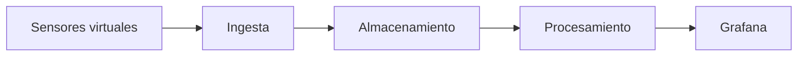

# Proyecto 03 · Smart City con FIWARE

## Descripción y objetivo

Simular una ciudad inteligente (Smart City) con la plataforma FIWARE, integrando sensores virtuales para la captura, almacenamiento y visualización de datos en tiempo real, replicando un entorno urbano digitalizado analizable con herramientas de inteligencia de negocio.

## Arquitectura



## Fuentes de datos

| Fuente | URL / origen | Formato | Frecuencia de actualización | Licencia | Última ingesta |
|---|---|---|---|---|---|
| Sensores virtuales | — | — | — | — | — |

## Estructura del repositorio

| Carpeta / fichero | Contenido |
|---|---|
| `ingesta/` | Scripts de ingesta de datos |
| `etl/` | Transformaciones |
| `dashboard/` | Visualización en Grafana |
| `data/exported/` | Ficheros de datos exportados |
| `data/raw/` | Datos en bruto |
| `data/staged/` | Datos intermedios |
| `data/curated/` | Datos finales para la visualización |
| `.env` | Variables de entorno. Hay que crearlo a partir de `.env.example` |
| `.env.example` | Plantilla de variables de entorno (actualmente vacía) |

## Cómo desplegar el entorno

```bash
cp .env.example .env     # crea el fichero de variables de entorno
```

Todavía no hay entorno Docker ni servicios definidos. 

`.env.example` está vacío: aún no define ninguna variable.

## Bitácora de prácticas

### Bloque 0 · Entorno

**Objetivo:** crear el repositorio Git, la estructura de carpetas, el `.gitignore`, el entorno Docker y el README.

**Pasos realizados:**

- Creación de las ramas `main` y `develop` para separar el resultado final del desarrollo.
- Creación de la estructura de carpetas.
- Creación del `.gitignore`.
- Creación de `.env.example` y `.env` (vacíos, sin Docker por ahora).

**Problemas encontrados y solución:** —

**Resultado:** —

## Decisiones técnicas

| Decisión | Alternativa descartada | Motivo |
|---|---|---|
| Ramas `main` y `develop` | Trabajar solo en `main` | Separar el resultado final del desarrollo |

## Incidencias resueltas

## Resultado final
